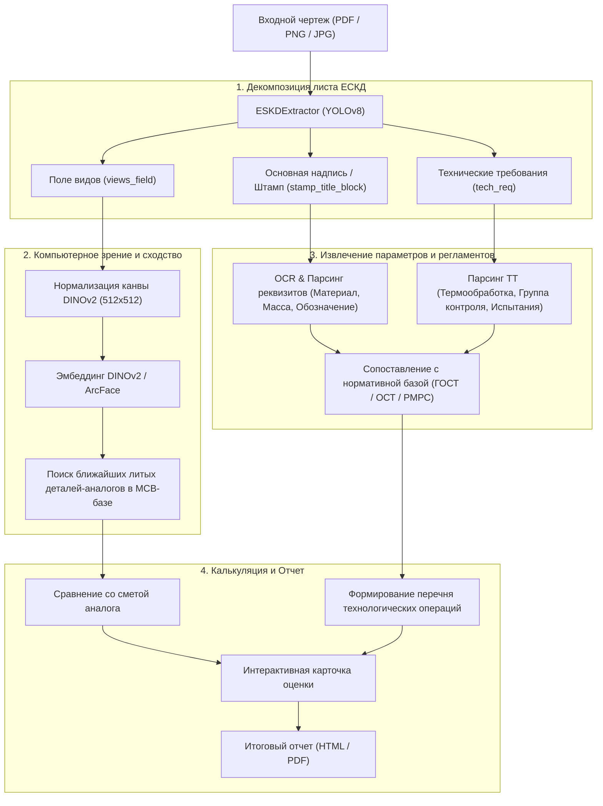

# ⚙️ Архитектура и Пайплайн системы

> **Теги:** #архитектура #пайплайн #ml_system #workflow

---

## 🔄 Сквозной пайплайн обработки чертежа

Система состоит из нескольких ключевых этапов, образующих непрерывный конвейер обработки входной документации:

---

## 🧩 Ключевые модули кодовой базы

| Путь к файлу / модулю | Назначение | Ключевая технология |
| :--- | :--- | :--- |
| `eskd_yolo_best.pt` | Обученные веса детектора элементов чертежа | YOLOv8 (Ultralytics) |
| `yolo_extractor.py` | Класс `ESKDExtractor` для нарезки слоев чертежа | PyMuPDF + YOLO + Pillow |
| `generate_yolo_dataset.py` | Генератор синтетических листов чертежей ЕСКД | Многопроцессорная генерация |
| `train_yolo.py` | Обучение детектора разметки чертежа | PyTorch + Ultralytics |
| `analogs/` | Модуль подбора деталей-аналогов | DINOv2, ArcFace, ruCLIP |
| `analogs/app/demo.py` | Главное приложение для анализа и генерации отчетов | Веб-интерфейс / HTML рендер |
| `pt_skript/convert_mcb_to_drawings.py` | Рендеринг проекций из 3D-моделей MCB | Векторные проекции 3D |

---

## 🔗 Связанные заметки
- [[00 - Главная (MOC)|🏠 Вернуться на Главную]]
- [[03 - Детекция ЕСКД (YOLOv8)|📐 Детекция ЕСКД (YOLOv8)]]
- [[04 - Поиск аналогов и Компьютерное зрение|🔍 Поиск аналогов и Компьютерное зрение]]
- [[06 - Демо-приложение и Генерация отчетов|📊 Демо-приложение и Генерация отчетов]]
