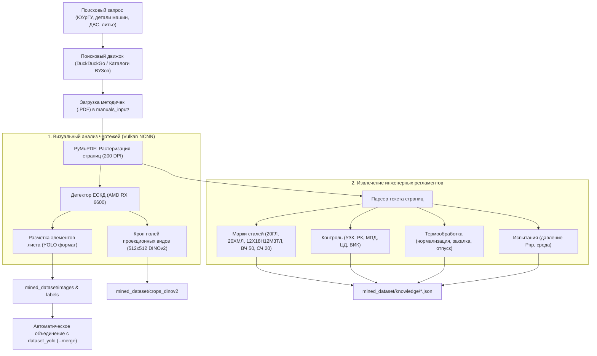

# 🌐 Сбор датасета и Парсинг методичек (Miner)

> **Теги:** #парсинг #датасеты #методички #юургу #детали_машин #vulkan #генератор

---

## 🎯 Зачем нужен сбор данных из методичек и учебников?

Для точной оценки стоимости уникальных литых изделий в ООО «БВК» и классификации деталей нейросеть должна обладать широким кругозором:
1. **Разнообразие геометрии:** Видеть не только базовые синтетические цилиндры, но и сложные составные узлы (корпуса редукторов, клапаны, крышки, задвижки, поршни, элементы ДВС, лопатки турбин).
2. **Технологическая база знаний:** Автоматически накапливать связки «деталь $\leftrightarrow$ марка стали $\leftrightarrow$ виды контроля $\leftrightarrow$ термическая обработка».
3. **Снижение ошибок оценки:** Чем больше реальных чертежей и регламентов видит модель при обучении, тем точнее она выделяет проекции и сопоставляет деталь с базой аналогов.

---

## ⚙️ Архитектура `manual_dataset_miner.py`

Конвейер объединяет веб-поиск, компьютерное зрение и извлечение инженерных знаний:



---

## 🛡️ Жесткие фильтры качества (Quality Gates v2.0)

Чтобы исключить попадание книжного текста, предисловий и водяных знаков сторонних библиотек (например, «Репозиторий БГАТУ») в обучающий датасет:
1. **Текстовый фильтр:** Страницы, содержащие более 350 символов сплошного текста, автоматически отклоняются как текстовые страницы учебника.
2. **Стоп-слова:** Фильтруются страницы с паттернами `репозиторий`, `удк`, `ббк`, `isbn`, `оглавление`, `введение`, `титульный лист`.
3. **Плотность геометрии:** Проверяется наличие не менее 40 векторных примитивов на странице.
4. **Порог площади:** Поле видов чертежа должно покрывать не менее 12% площади страницы при уверенности детектора $\ge 0.45$.
5. **Изоляция в Staging:** Все новые результаты сохраняются в `mined_dataset/staging_images/` и не попадают в рабочий датасет без явного аудита.

---

## 🚀 Команды запуска

### 1. Автоматический поиск и парсинг из интернета:
```powershell
# Поиск методичек по деталям машин и чертежам:
.\venv\Scripts\python.exe manual_dataset_miner.py --search "чертежи деталей машин методические указания ЮУрГУ" --count 2

# Поиск по двигателям и литью:
.\venv\Scripts\python.exe manual_dataset_miner.py --search "конструкция двигателя литье чертеж детали" --count 2
```

### 2. Пакетная обработка локальных PDF-файлов:
Положите любые методички ЮУрГУ или отраслевые справочники в папку `manuals_input/` и выполните:
```powershell
.\venv\Scripts\python.exe manual_dataset_miner.py --input-dir manuals_input --max-pages 50
```

### 3. Автоматическое слияние с обучающим датасетом YOLO:
```powershell
.\venv\Scripts\python.exe manual_dataset_miner.py --input-dir manuals_input --merge
```

---

## 📁 Структура полученных данных (`mined_dataset/`)
- `images/` — страницы с чертежами в разрешении 200 DPI.
- `labels/` — файлы аннотаций YOLO (`<class> <x> <y> <w> <h>`).
- `crops_dinov2/` — центрированные проекции деталей $512\times512$ на белом фоне для поиска аналогов.
- `knowledge/` — структурированные JSON-файлы с извлеченными марками сталей, методами контроля и регламентами.

---

## 📚 Скачанные методички и учебники (`manuals_input/`)

На текущий момент в базу собрано **8 методических пособий и учебников**:
1. `design-of-foundry-tooling-and-technology-production-of-castings-in-sand-molds.pdf` (1.57 МБ) — Проектирование литейной оснастки и технологии производства отливок в песчаных формах (ХТС).
2. `_D0_A2_D0_B0_D0_B2_D1_82_D0_B8_D0_BB_D0_BE_D0_B2.pdf` (3.97 МБ) — Тавтилов: Литейные процессы, песчаные формы и технологичность литых деталей.
3. `RSVPU_2017_740.pdf` (0.87 МБ) — Технология конструкционных материалов и литейного производства.
4. `SUSU_DVS_Dvigateli_Teoriya_i_Konstruktsiya.pdf` (6.5 МБ) — ЮУрГУ: Двигатели внутреннего сгорания (теория, конструкции корпусных деталей, поршней и блоков).
5. `SUSU_Metodichka_Mashinostroenie.pdf` (1.0 МБ) — ЮУрГУ: Методические указания по технологии машиностроения.
6. `Tekhnologiya_Liteynogo_Proizvodstva_Otlivki.pdf` (3.4 МБ) — Технология литейного производства и проектирование отливок.
7. `Detali_Mashin_i_Osnovy_Konstruirovaniya.pdf` (2.4 МБ) — Детали машин и основы конструирования.
8. `CHertezhi-detalej-mashin.pdf` (3.0 МБ) — Альбом рабочих чертежей деталей машин по ГОСТ и ЕСКД.

**Результаты расширения датасета:**
- Обработано страниц: `148`
- Извлечено и автоматически размечено чертежей: `62`
- Основной обучающий датасет `dataset_yolo` вырос с 428 до **512 изображений**!

---

## 🔗 Связанные заметки
- [[00 - Главная (MOC)|🏠 Вернуться на Главную]]
- [[03 - Детекция ЕСКД (YOLOv8)|📐 Детекция ЕСКД (YOLOv8)]]
- [[05 - Датасеты и синтетические данные|📦 Датасеты и синтетические данные]]
- [[09 - План работ и Задачи (Roadmap)|✅ План работ и Задачи (Roadmap)]]
