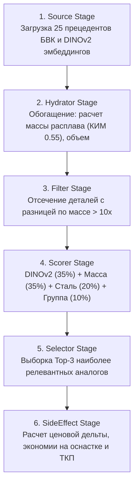

# 🔍 Рекомендательная система аналогов (RecSys CBR & DINOv2) и Генератор ТКП

> **Теги:** #бвк #recsys #dinov2 #cbr #ценообразование #отчеты #pdf #excel
> **Связанные заметки:** [[00 - Главная (MOC)|Карта знаний]], [[04 - Поиск аналогов и Компьютерное зрение|Компьютерное зрение]], [[11 - Калькулятор себестоимости и Веб-сервис (Web UI)|Веб-интерфейс]], [[14 - Подключенные Скиллы (Awesome Skills)|Скиллы]]

---

## 1. Концепция Case-Based Reasoning (CBR) в литейном производстве

При оценке уникальной отливки единичного заказа заводские технологи и экономисты сталкиваются с трудоемким нормированием:
- Разработка технологии заливки и литниково-питающей системы (ЛПС) занимает **до 2–3 недель**;
- Проектирование и изготовление деревянного или пластикового модельного комплекта на станках с ЧПУ стоит **от 150 000 до 450 000 рублей**;
- Риск литейного брака при заливке «с нуля» без отработанных режимов охлаждения достигает **8–12%**.

**Решение системы:**  
При загрузке чертежа конвейер **RecSys** сопоставляет геометрию и технологические требования детали с **базой выполненных заказов ООО «БВК»**. Если на складе завода уже имеется аналогичный модельный комплект, система рекомендует адаптировать существующую оснастку, экономя клиенту сотни тысяч рублей и сокращая срок запуска в производство на 25 рабочих дней.

---

## 2. Архитектура 6-стадийного конвейера RecSys

Конвейер спроектирован по шаблону `recsys-pipeline-architect`:

### Мультимодальная функция ранжирования (Scorer)

$$S_{total} = 0.35 \cdot S_{visual} + 0.35 \cdot S_{mass} + 0.20 \cdot S_{material} + 0.10 \cdot S_{group}$$

1. **Визуальный скор ($S_{visual}$)**: Косинусное сходство между нормализованным 384-мерным вектором проекций чертежа $\mathbf{q}$ и эталонным вектором прецедента $\mathbf{c}_i$:
   $$S_{visual} = \max\left(0, \frac{\mathbf{q} \cdot \mathbf{c}_i + 1}{2}\right)$$
   Инференс модели `facebookresearch/dinov2` (`dinov2_vits14`) на процессоре занимает **~46 мс**.
2. **Массовый скор ($S_{mass}$)**: Логарифмическая близость масс готовых отливок:
   $$S_{mass} = \exp\left(-\left|\ln \frac{M_{query}}{M_{catalog}}\right|\right)$$
3. **Материальный скор ($S_{material}$)**: $1.0$ при точном совпадении марки стали (например, `20ГЛ` и `20ГЛ`), $0.8$ при совместимом классе легирования, $0.4$ для разнородных сталей.
4. **Контрольный скор ($S_{group}$)**: Степень соответствия группы отливки по ГОСТ 977-88 (1, 2, 3 или 3а).

---

## 3. База выполненных заказов завода (25 позиций)

База (`casting_catalog.json`) и предварительно рассчитанные векторы (`catalog_embeddings.npz`) охватывают все ключевые классы ЕСКД литейного завода:
- **Класс 05 (Корпуса и арматура):** Корпуса клапанов ВД DN 200 PN 160, задвижки клиновые DN 300, корпуса редукторов, центробежные насосы;
- **Класс 01 (Диски и фланцы):** Фланцы приварные DN 250, диски упорные турбин, фланцы воротниковые спецпрофиля;
- **Класс 02 (Колеса и шкивы):** Шкивы клиноременные, рабочие колеса центробежных насосов, зубчатые венцы приводов;
- **Класс 03 (Втулки и стаканы):** Втулки направляющие скольжения, стаканы подшипников, гильзы гидропрессов;
- **Класс 04 (Валы и оси):** Валы ступенчатые тихоходные, оси балансиров;
- **Класс 06 (Кронштейны и петли):** Кронштейны поворотные навески, проушины шарнирные мостовых кранов;
- **Класс 07 (Рычаги и крюки):** Рычаги кривошипов, крюки грузовые чалочные 15т;
- **Класс 08 (Опорные плиты):** Плиты фундамента турбоагрегатов, траверсы грузоподъемные.

---

## 4. Экспорт официальных документов (`report_exporter.py`)

Для производственно-экономического отдела (ПЭО) и коммерческих служб реализован экспорт в двух стандартных форматах:

### 1. Официальное Технико-Коммерческое Предложение (PDF)
- Генератор: `ReportLab Platypus` с поддержкой кириллицы (`ArialCyr`);
- Структура:
  1. Брендированная шапка **ООО «БВК» (ПГ КОНАР)**;
  2. Таблица технологических параметров литой заготовки (масса, расплав, термообработка, контроль НК);
  3. Калькуляционная ведомость затрат по 9 статьям с процентной долей и суммой;
  4. Аналитический блок прецедентов **RecSys DINOv2** с оценкой экономии на модельной оснастке;
  5. Подписи главного металлурга и коммерческого директора.

### 2. Калькуляционная ведомость отливки (Excel `.xlsx`)
- Генератор: `OpenPyXL`;
- Оформление в корпоративной палитре БВК (Deep Navy / Industrial Slate);
- Форматирование числовых ячеек (`#,##0 ₽` и `0.0%`);
- Готовая структура для импорта в заводскую ERP/1С.

---

## 5. Интеграция в Веб-Интерфейс

Во вкладке **«📄 Экспорт документов (PDF / Excel)»** технологу доступны кнопки формирования файлов в 1 клик.  
При пересчете параметров (массы, марки стали, группы отливки) отчеты мгновенно обновляются с учетом актуальных данных.
